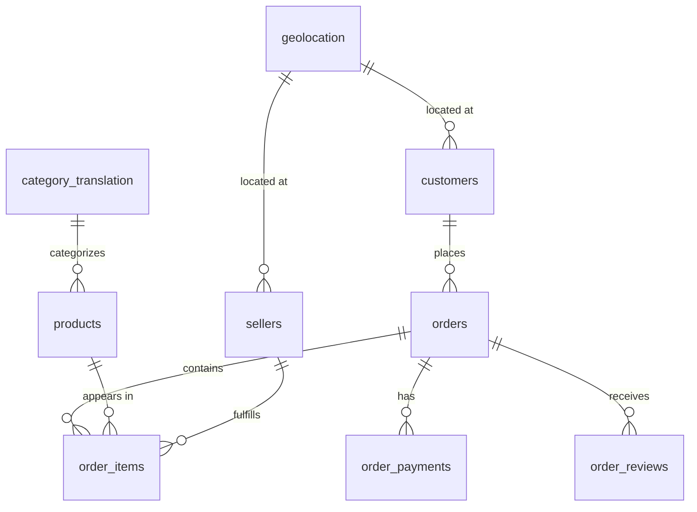

# Olist Data Model Documentation

This document outlines the core tables, primary keys, composite keys, and relational structures of the Olist e-commerce database analyzed during Day 1.

## 1. Entity-Relationship Diagram (ERD)

## 2. Core Tables & Primary Keys

- **`orders`**
  - **Primary Key:** `order_id`
  - **Description:** Contains main transaction records, purchase timestamps, order statuses, and delivery dates (99,441 rows).

- **`customers`**
  - **Primary Key:** `customer_id`
  - **Description:** Represents unique customer-order instances, linked to `customer_unique_id` for tracking repeat buyers across multiple orders.

- **`order_items`**
  - **Composite Primary Key:** (`order_id`, `order_item_id`)
  - **Description:** Details individual items purchased within each order, linking products and sellers.

- **`order_payments`**
  - **Composite Primary Key:** (`order_id`, `payment_sequential`)
  - **Description:** Captures payment methods, installments, and transaction values for orders.

- **`order_reviews`**
  - **Composite Primary Key:** (`review_id`, `order_id`)
  - **Description:** Stores customer feedback scores and review comments associated with orders.

- **`products`**
  - **Primary Key:** `product_id`
  - **Description:** Catalog of products sold on the platform, including dimensions, weights, and category references.

- **`sellers`**
  - **Primary Key:** `seller_id`
  - **Description:** Information regarding merchants and sellers fulfilling order items.

- **`product_category_name_translation`**
  - **Primary Key:** `product_category_name`
  - **Description:** Translates Portuguese product categories into English.

## 2. Geolocation Notes

- **`geolocation`**
  - **Note:** Postal codes (`geolocation_zip_code_prefix`) do not form a strict primary key because individual zip codes span multiple coordinate points and states, resulting in a many-to-many relationship rather than a direct parent-child foreign key lookup.
