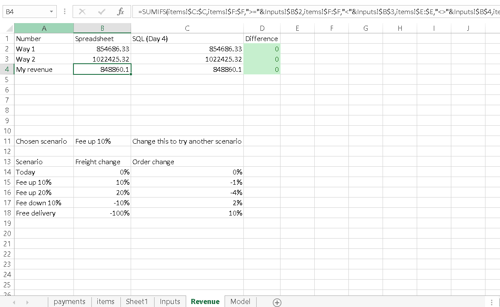
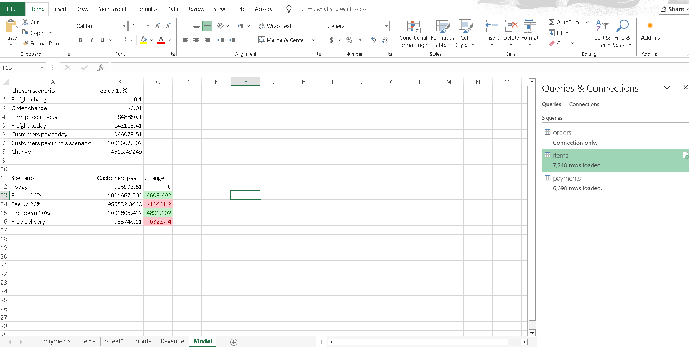

## Part 0

### 1. Explanation of the four numbers in the hardcoded formula:

- **854686.33:** Way 1 item revenue for August 2018 (strict sum of item prices).
- **148622.14:** Total freight value associated with those August orders.
- **19194.21:** Payments linked to orders that have no matching item records in the database.
- **-77.36:** Small reconciliation differences between item totals and payment values.

### 2. Rules broken by the hardcoded formula:

- **No hardcoded numbers inside formulas rule:** The formula embeds business numbers and financial totals directly as plain text rather than referencing input cells.
- **Auditing/Transparency rule:** A coworker or manager checking this sheet cannot trace where these four numbers originated, what orders they filter, or how to update the formula for September 2018. A number that nobody can check is a number that nobody should trust.

## Part 1 — Take the data out of the database

Extracted August 2018 orders, items, and payments from the database using Python and saved them as standalone CSV files in `data/work/` to be used for spreadsheet auditing.

- **Orders count (`aug2018_orders.csv`):** 6,512 rows
- **Items count (`aug2018_items.csv`):** 7,248 rows
- **Payments count (`aug2018_payments.csv`):** 6,698 rows

## Part 2 — Load the files, and join them in the spreadsheet

- **Rows Count After Join:**
  - `items` sheet: 7,248 rows
  - `payments` sheet: 6,698 rows
- **Comparison with Part 1:** The row counts after the join remain exactly identical to the original extracted CSV files (7,248 for items and 6,698 for payments).
- **Why must they be the same?** A `LEFT JOIN` (or Left Outer Join) preserves every single row from the left table (the items/payments) exactly as they are. Since each item and payment record corresponds to a valid order in our filtered August dataset, no rows should ever be dropped or duplicated during a proper 1-to-many relationship join. As established in Day 2's primary-foreign key rules, preserving row counts guarantees that no data leakage or unexpected Cartesian products occurred.

- **Applied Steps (Excel Power Query / XLOOKUP Summary):**
  - Loaded `aug2018_orders.csv`, `aug2018_items.csv`, and `aug2018_payments.csv`.
  - Promoted headers, verified data types (ensuring `order_purchase_timestamp` was set to Date/Time and numeric columns as Decimal).
  - Merged `items` and `payments` with `orders` using a `Left Outer Join` on `order_id` to append `order_status` and `order_purchase_timestamp`.

## Part 3 — Inputs and SUMIFS: Day 4 again, to the cent

- **Spreadsheet Numbers & Differences:**
  - **Way 1:** Spreadsheet = 854,686.33 | SQL (Day 4) = 854,686.33 | Difference = 0
  - **Way 2:** Spreadsheet = 1,022,425.32 | SQL (Day 4) = 1,022,425.32 | Difference = 0
  - **My revenue:** Spreadsheet = 996,973.51 | SQL (Day 4) = 996,973.51 | Difference = 0

- **Formulas Used:**
  - **B2 (Way 1):**
    `=SUMIFS(items!$C:$C, items!$F:$F, ">="&Inputs!$B$2, items!$F:$F, "<"&Inputs!$B$3)`
  - **B3 (Way 2):**
    `=SUMIFS(payments!$D:$D, payments!$F:$F, ">="&Inputs!$B$2, payments!$F:$F, "<"&Inputs!$B$3)`
  - **B4 (My revenue):**
    `=SUMIFS(items!$G:$G, items!$F:$F, ">="&Inputs!$B$2, items!$F:$F, "<"&Inputs!$B$3, items!$E:$E, "<>"&Inputs!$B$4, items!$E:$E, "<>"&Inputs!$B$5)`

- **Revenue Sheet Screenshot:**
  

## Part 4 — A what-if model

- **Scenario Results Summary:**
  - **Today (Base):** Customers Pay = $R 996,973.51 | Change = $R 0.00
  - **Fee up 10%:** Customers Pay = $R 1,001,667.00 | Change = +$R 4,693.49
  - **Fee up 20%:** Customers Pay = $R 985,532.34 | Change = -$R 11,441.20
  - **Fee down 10%:** Customers Pay = $R 1,001,805.41 | Change = +$R 4,831.90
  - **Free delivery:** Customers Pay = $R 933,746.11 | Change = -$R 63,227.40

- **Model Insights:**
  - **Most Revenue:** The **`Fee down 10%`** scenario brings in the highest revenue ($R 1,001,805.41), as lower delivery fees stimulate a 2% increase in order volume, outperforming the base model.
  - **Least Revenue:** The **`Free delivery`** scenario brings in the lowest revenue ($R 933,746.11), because eliminating delivery fees entirely causes a major revenue drop that the 10% increase in orders cannot recover.

- **Two Model Limitations:**
  1. **Excludes Operational Logistics Costs:** The model only analyzes gross revenue paid by customers, ignoring the actual delivery costs paid to shipping providers.
  2. **Static Assumptions on Order Elasticity:** The percentage changes in orders are arbitrary estimates rather than data-driven price elasticity curves.

- **Model Sheet Screenshot:**
  

## Part 5 — Errors and Learnings

- **Error:** Getting `#N/A` and `0` values in the Model sheet's INDEX/MATCH lookup.
- **What it taught me:** I learned that the exact text in the lookup cell (`Chosen scenario`) must perfectly match the text in the reference list. If it's missing or misspelled, Excel's `MATCH` function cannot find it and breaks the whole model.
