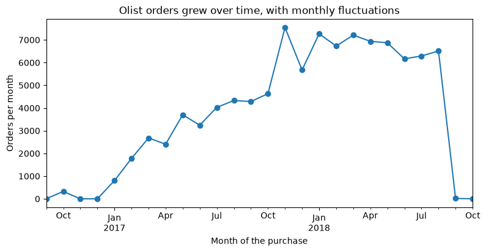

## The question

How did Olist's orders change from 2016 to 2018?

## The answer

Olist's monthly orders increased significantly from the beginning of the dataset through 2017, showing overall growth in order volume. During 2018, the monthly order counts showed fluctuations, so the monthly changes should be considered when interpreting the overall trend.

## How sure I am

The results are based on the cleaned orders table in PostgreSQL and the monthly order counts. The chart shows the changes in order volume, but it does not explain the reasons behind these changes.

## What to do next

Investigate the factors that may explain the monthly changes in order volume. Further analysis could compare monthly sales, customer activity, and order patterns to better understand the reasons behind the trend.
