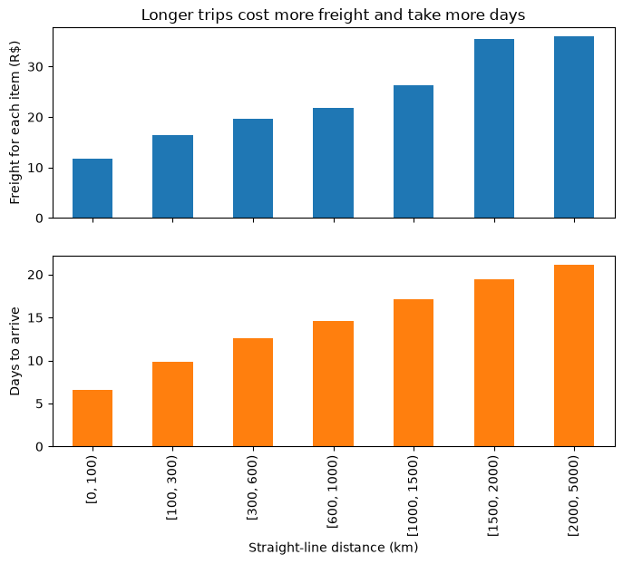
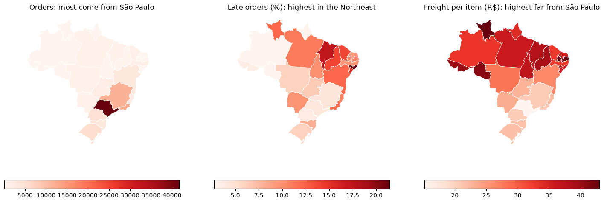

## The question

Where do deliveries cost the most and arrive late most often, and does distance explain it?

## The answer

Longer delivery distances generally have higher freight costs and longer delivery times. Some states also have higher late delivery rates, even when they have fewer orders.

## How sure I am

The calculated distances are straight-line estimates between ZIP Code points, not actual road or transportation routes. A ZIP Code point represents an area rather than the exact customer or seller address, so the distance results are approximate.

## What to do next

Further analysis could include actual transportation routes and other factors that affect delivery time and freight costs. Comparing delivery performance across states using percentages and averages can also help identify areas that need improvement.
