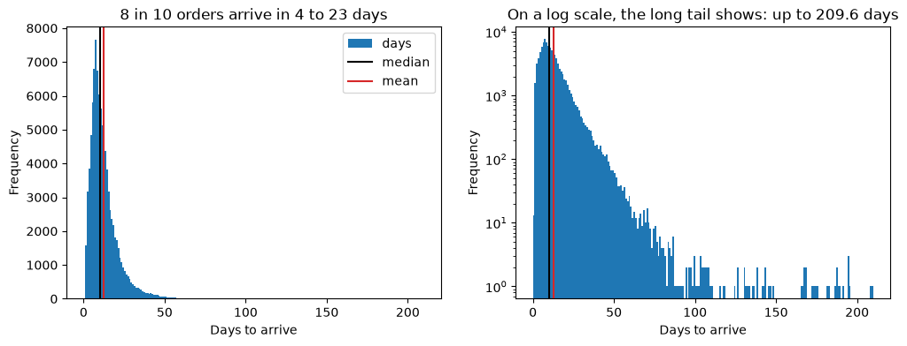
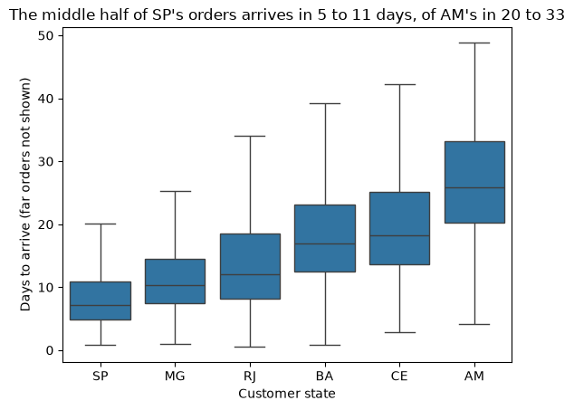

# Day 12 — Distributions and Why the Average Can Be Wrong

## The question

How long does a typical order take to arrive, and how long do the slow ones take?

## The answer

A typical delivered order takes approximately 10.2 days (P50), while 90% of orders arrive within 23.1 days and 99% within 46.0 days. Delivery performance varies across states, with AM showing much longer delivery times than SP.

## How sure I am

These results include only orders with a recorded delivery date. Orders without a delivery date were excluded because their actual delivery duration could not be calculated. The percentiles describe historical delivery performance and do not guarantee future delivery times.

## What to do next

Investigate the unusually slow deliveries and the differences between states, especially AM and RJ. Monitor the median, P90 and P99 regularly to identify changes in delivery performance and determine where improvements are needed.
