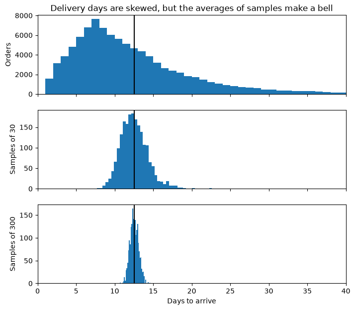
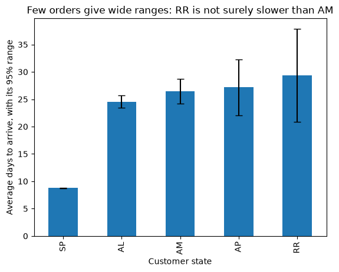

# Day 13 — Uncertainty, Seen by Simulation First

## The question

Which states can we rank by delivery days, and which are too small to judge?

## The answer

SP has a relatively low and precise average delivery time of 8.76 days, with a narrow 95% confidence interval from 8.69 to 8.83 days. RR has the highest observed average at 29.39 days, but its wide interval overlaps those of AM and AP, so we cannot confidently determine which of these states is truly the slowest.

## How sure I am

The analysis includes only orders with a recorded delivery date. Orders without a delivery date were excluded because their actual delivery duration could not be calculated. Estimates for states with small numbers of orders have wider confidence intervals and are therefore less precise.

## What to do next

Collect more delivery data for RR, AM and AP, and investigate the operational causes of their longer delivery times. Monitor state averages together with their confidence intervals instead of prioritizing states based on their observed averages alone.
