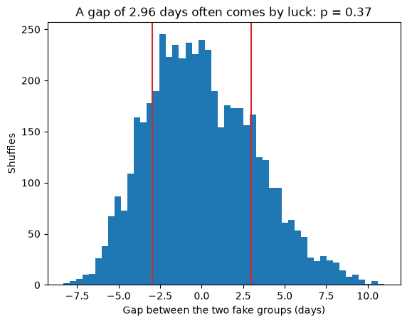
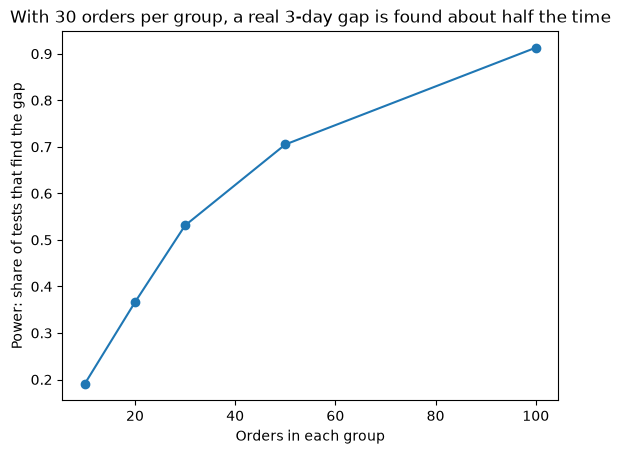

## The question

Should the ops manager change RR's carrier, because RR's orders take 3 days longer than AM's?

## The answer

The analysis does not provide enough statistical evidence to conclude that RR's delivery times are truly different from AM's. The observed average gap is 2.96 days, but the shuffle test produced a p-value of 0.37, meaning that a gap this large could occur by chance.

## How sure I am

The large p-value does not prove that RR and AM have the same delivery performance. It only tells us that the observed difference is not unusual enough to reject the assumption of no real difference. RR also has only 41 orders, so the sample may be too small to detect a real difference reliably.

## What to do next

I recommend collecting more delivery data for RR before making a carrier-change decision. The operations team should also investigate other possible causes of delays and compare performance again when a larger sample is available.
