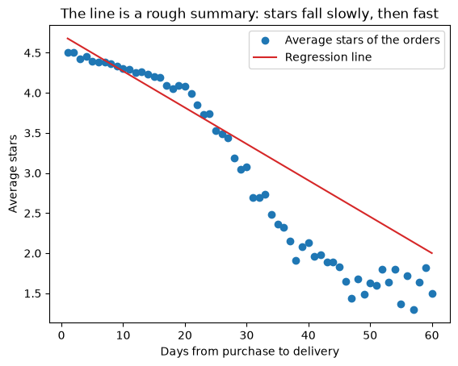
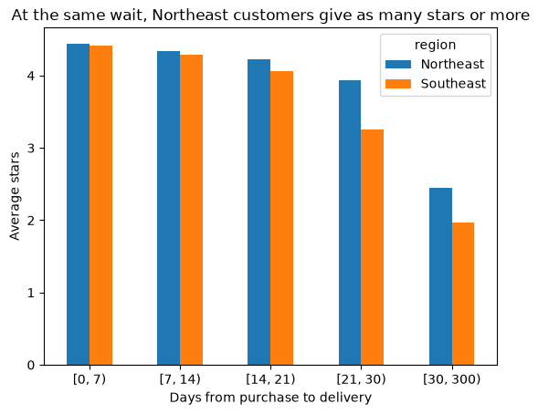

## The question

What makes customers give low stars, and what should Olist work on first?

## The answer

Delivery delays have the strongest negative relationship with customer review scores (correlation: -0.39), followed by delivery time (correlation: -0.33). A simple regression model estimates a decrease of about 0.045 stars for each additional delivery day.

The regional comparison also shows that the Northeast often receives equal or higher scores than the Southeast within the same delivery-time groups. Olist should prioritize investigating delivery delays and improving delivery reliability.

## How sure I am

The analysis shows associations between delivery performance and customer satisfaction, but it does not prove causation. Other factors, such as seller performance, distance, and customer expectations, may also influence review scores.

The regression model explains only about 11% of the variation in review scores, so other factors remain important.

## What to do next

Olist should investigate late deliveries by seller, region, and carrier to identify where delays occur most frequently. It should also monitor delivery performance and customer review scores together to evaluate whether improvements lead to better customer experiences.
