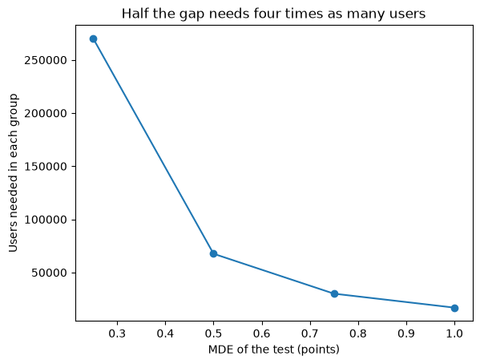
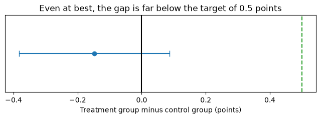

# Day 16 — A/B Testing Finding

## The question

Should the shop switch to the new landing page?

## The answer

**No. The shop should keep the old landing page.**

The new landing page showed an estimated conversion decrease of 0.15 percentage points compared with the old page. Its confidence interval ranged from -0.38 to +0.09 percentage points, which does not reach the business target of +0.50 points.

## How sure I am

The confidence interval ranges from -0.38 to +0.09 percentage points, and the p-value is 0.22. The test had enough users to detect the planned improvement of 0.50 percentage points, so the results provide sufficient evidence that the new page did not demonstrate the required business improvement.

## What to do next

Keep the old landing page instead of switching to the new one. Any future landing page changes should be tested again, while monitoring conversion rate, page loading time, and order return rate.
